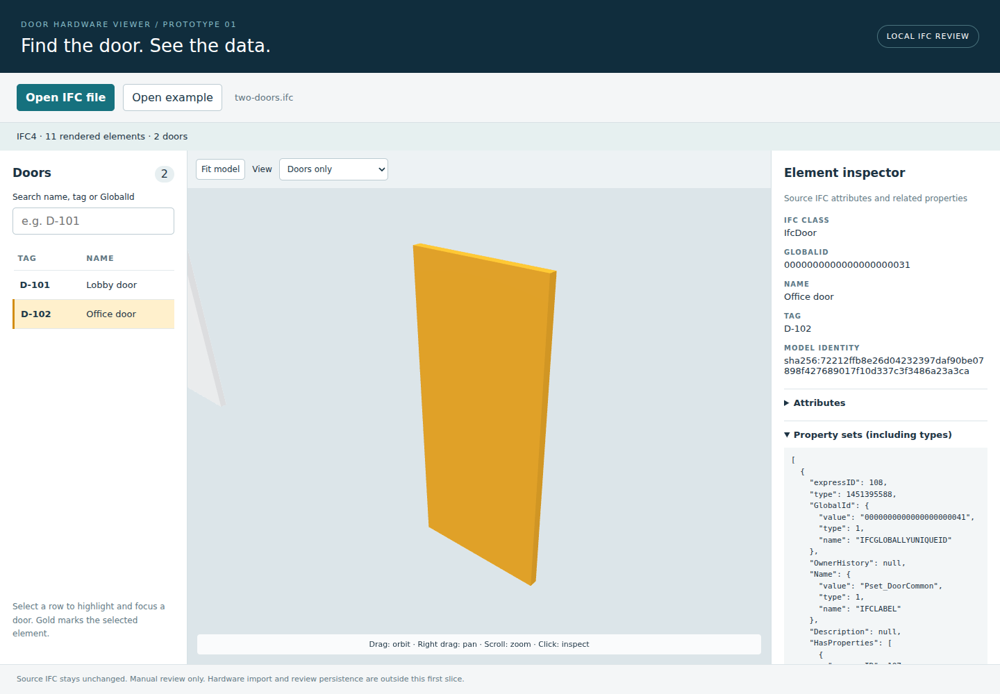

# Current verification — association/review slice (2026-10-30)

Production build passed strict TypeScript and Vite bundling. **19 tests passed**: prior 11 import/viewer tests plus five workflow model tests and three real-browser workflow tests. Published source is compared by Git tree hash to this tested local source.

New verification:

- Manual hardware assignment, all item fields, reassignment/removal, statuses/comments, combined filters and persistence after refresh/reopening the IFC.
- Explicit model scoping, exact GlobalId proposals/application, exact selected-property matching, duplicate/invalid IDs, competing schedule targets and conflicting source identities.
- **Real duplicate-mark IFC:** changed both fixture door Tags to DUP, imported a mark-only schedule, confirmed the queue was ambiguous and bulk application disabled, then manually selected GlobalId ...0031. Only that door received hardware; the other remained unassigned.
- Changed IFC bytes produce a different model fingerprint; previous assignments do not appear and source schedules report wrong-model.
- Optional marker renders and can be clicked to select the associated door/table row. UI screenshot visually inspected for layout. Occlusion/overlap culling is implemented, but not comprehensively benchmarked or pixel-tested across complex building models.
- Original imports, provenance and schedule assignments are byte-for-byte unchanged by association operations. Before/after assignment and status history, model-scoped comments, unlink/removal behavior and stale-preview protection are tested.
- Existing damaged-storage/quota/stale-tab, real IFC loading/property inspection and importer regressions continue to pass through the shared store.

No new libraries were added. Chromium/SwiftShader harness and reproduction commands remain as described in earlier verification. Current limits and reviewer acceptance steps are in [ASSOCIATION-REVIEW.md](ASSOCIATION-REVIEW.md). Earlier verification below is retained as history; earlier scope exclusions describe those versions.

# Current verification — hardware import slice (2026-10-30)

`npm run build` passed strict TypeScript and Vite production build. **11 tests passed**: five import/model tests, four import browser workflows and two IFC viewer regression workflows, against production assets. Chromium was supplied via the same temporary @sparticuz harness described below. Browser tests use actual local file inputs, downloads and localStorage; storage failure is deliberately injected in one test to verify no commit occurs.

Verified:

- Multiple hardware items in one set, a shared set assigned to two doors, normalized UUID links and identity stability across preview/reload/export.
- CSV quoted commas, doubled quotes, multiline values, BOM handling, string identifiers/leading zeros, custom mappings and unrecognized fields.
- JSON version/type checks; missing required fields, duplicate IDs/assignments/GlobalIds, invalid quantities and references block apply.
- All mapped rows appear in preview; invalid source text and row errors remain downloadable. Existing identifiers never overwrite existing data.
- CSV correction/re-preview, explicit atomic apply, readable sets/assigned doors, local persistence, backup source/provenance preservation.
- Quota failure, another-tab change, damaged saved graph and recovery export preserve existing data and block unintended changes.
- Original real-IFC load, source property inspection, table/canvas selection, search, transparency/isolation, navigation and error/reopen regression tests still pass.

UI screenshot was inspected locally for layout. New limitations: imports do not bind schedule records to IFC model geometry; review/comment types exist but editing UI does not; backup restore UI is not implemented; comma-delimited UTF-8 CSV only; no large-schedule benchmark, streaming or partial apply. Full source provenance increases localStorage use; exceeding quota reports an unapplied import. See [HARDWARE-IMPORT.md](HARDWARE-IMPORT.md).

The following is retained **slice 1 verification history**; scope statements below describe that earlier version.

# Verification — 2026-10-30

## Results

`npm run build` passed (strict TypeScript followed by Vite production bundling). The emitted bundle includes version-matched `web-ifc` WASM in dist/assets. Vite reports a large JS chunk (~4 MB uncompressed); this is expected for this initial bundled geometry engine and is not hidden.

`npm test` passed: **2 browser tests**, using the production preview with Chromium 153.0.8010.0 and SwiftShader WebGL2 in this environment. No mocked IFC parser, mesh data, property response or viewer adapter was used. Screenshot was visually inspected: real door geometry is gold, D-102 is selected, and its GlobalId/Name/Tag and source properties are present.

Covered:
- Upload original two-doors.ifc through the local file input: IFC4, 11 rendered elements, 2 doors.
- Select D-101: class IfcDoor, expected GlobalId, instance FireRating = 60 min, selected table row.
- Doors-only isolation; table focus on D-102; clear by clicking canvas background; click camera target on rendered geometry and verify D-102 selected in table and inspector.
- Search by tag and no-match state; transparent-context control; fit; exercise orbit, right-button pan and mouse-wheel zoom.
- Invalid text file gives useful error and disables model actions; example reopens successfully and properties remain inspectable.
- Modified IFC fixtures with duplicate / missing door GlobalIds are selectable separately and display identity warnings.
- Browser pageerror collection is empty on main workflow.

Independent Node web-ifc check also parsed the same source fixture: IFC4, 11 meshes, two IfcDoor entries and Pset_DoorCommon.FireRating. The fixture was corrected during verification to use proper STEP real number syntax and explicit 2D profile placement; final parser run emitted no fixture warnings.

Reproduce: `npm ci`, `npx playwright install --with-deps chromium`, `npm run build`, `npm test`. Optional `CHROMIUM_PATH` selects an installed browser. In this environment Playwright's browser download was truncated, so an independently obtained Chromium binary from @sparticuz/chromium was used with local SwiftShader libraries. This temporary harness is not an app dependency or shipped asset. CI uses Playwright's standard browser installation; its remote result is separate from this local run.

## Limits

- Only the included small IFC4 pavilion has been end-to-end tested. IFC2X3 and IFC4X3 are exposed by the parser but not validated with project models. No claim of universal IFC representation/exporter compatibility.
- No large-model benchmark. Parsing, per-line metadata enumeration and mesh creation run on the main thread; the loading message paints first but the browser can pause during conversion. No cancellation/progress percentage is promised. Suitable for small prototype models; worker processing / efficient fragments are future work.
- Navigation events are exercised; visual QA confirms rendering/highlight. Tests do not measure geometric camera accuracy or certify accessibility across all browser/device combinations.
- All source attributes are available in diagnostic JSON; property presentation is deliberately basic. Materials and spatial hierarchy are not separate inspector sections. Deep recursive attributes on unusually complex/cyclic files may be expensive or fail with an inspection error.
- Geometric openings in the fixture are built from wall pieces, not IfcOpeningElement relations. It is a legal original IFC test building, not a construction-ready design or a certification fixture.
- Missing or duplicate GlobalIds have session-only selection handles. Association persistence is not implemented. A byte-different IFC receives a new model identity; revision migration is future work.
- Doors without supported geometry remain listed and are counted in a warning; focusing them cannot invent geometry.
- Model replacement discards the previous model, including when the replacement fails. There are no saved review records yet.
- No login, upload service, hardware import, review comments/status, saved project state, automated matching or code compliance. Reloading the page requires reopening the file.
